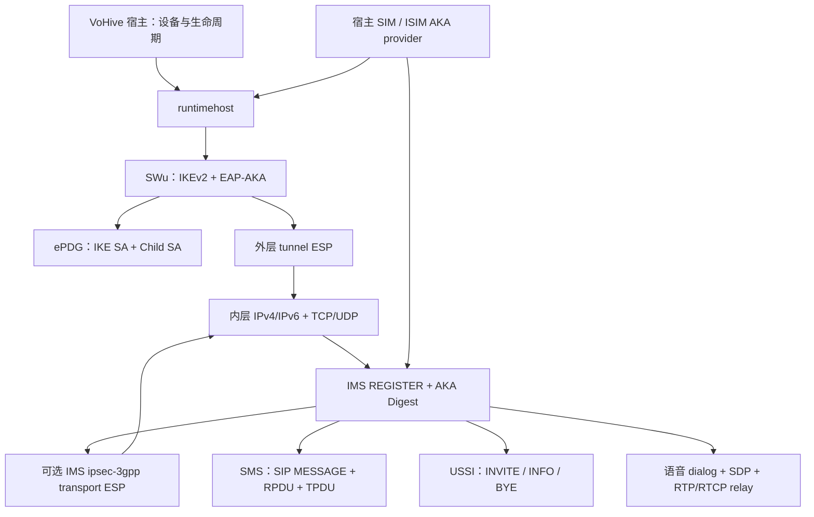

# VoHive v1.5.5-10u 静态分析补充与 vowifi-go 重写依据

本文补充用户提供的 `vowifi-go-rewrite-guide.md`，并将可复核的数据、原版行为与重写选择分开。分析固定于指定 release；宿主契约固定于分支 `rea` 的基点 `07b7b8691a2bb50db907219bcc7d7ae7f0263f65`。日期：2026-10-19（Asia/Taipei）。

**VoWiFi 是 SIM 认证、SWu 隧道、隧道内 IP 网络、IMS 注册及业务协议的组合。** 独立 SIP 客户端无法替代这个模块。此次没有运行原版可执行文件、访问真实 SIM 或向运营商发送认证、短信、USSD、语音、entitlement 请求。离线协议测试通过也不代表真实网络互通完成。

## 1. 目标身份与证据边界

| 项目 | 固定值 |
| --- | --- |
| 下载地址 | https://github.com/pexcn/docker-images/releases/download/vohive/vohive_v1.5.5-10u_linux_amd64 |
| SHA-256 | `2b080980c72fede3dbad1c9f8830bb51d0bc368b4acb576c4f2d27f9182eb59f` |
| 长度 | 57,958,562 bytes |
| 格式 | ELF64、little-endian、Linux amd64 |
| Go 版本 | `go1.26.3` |
| 主模块 / 私有模块 | `github.com/iniwex5/vohive` / `github.com/iniwex5/vowifi-go`，二者在此 artifact 中均为 `(devel)` |
| 构建选项 | `CGO_ENABLED=0`、`GOAMD64=v1`、`-trimpath=true`、tags `with_utls,nomsgpack` |

证据等级用于限定每条结论：

- **观察 / observed**：目标字节、Go 元数据、明确的指令/分支/调用、嵌入 YAML 原文、当前宿主源码调用。
- **导出 / derived**：通过同一目标的类型字段偏移、ELF VA 映射、初始化值和赋值指令，机械地解出结构数据。
- **推断 / inferred**：由若干观察组合出的架构解释；不声称完整控制流覆盖。
- **设计 / design**：独立重写的选择，不能作为原版行为的证据。
- **未知 / unknown**：缺少可靠数据或真实网络验证，不用现有兼容实现来填补。

| 编号 | 可复核来源 | 能支持的结论 |
| --- | --- | --- |
| R01 | [原样保存的 REA Go build-info Evidence](evidence/go-build-info.json)，ID `ev_7659ee49f6b7c4e0ebfc4c8209c712279efcb3e27b4517ca9b95277b306dc26f` | 目标指纹、Go 版本、模块与构建参数；不证明函数行为 |
| R02 | [REA 导出 bundle](evidence/rea-bundle.json) | 保存本轮实际取得的 Evidence schema；当前为 build-info 记录 |
| R03 | [最终定点 REA bundle](evidence/rea-focused-bundle.json)、[导出回执](evidence/rea-focused-900-export.json)、[关闭回执](evidence/rea-focused-901-close.json) | 7 个函数的实际 Ghidra 伪代码记录及元数据；用于与指令/字段交叉核对，不是原始 Go 源码 |
| L01 | [Go 函数表提取器](scripts/functions.go)，读取 `.gopclntab` | 69,081 个函数记录；私有模块前缀 2,419 个，含闭包/包装，并非 2,419 个功能 |
| L02 | GNU `objdump` 定点反汇编及本目录 `evidence/*.asm` | 指令、分支和普通直接调用；间接调用不自动解析 |
| L03 | [ELF / Go runtime descriptor 提取器](scripts/recover_artifact.py)、[类型字段](evidence/types.json)、[默认值](evidence/defaults.json)、[YAML 清单](evidence/presets-manifest.json) | 同一目标中的类型字段、初始化值、16 个嵌入 carrier YAML；属于本地静态观察/导出，不是 REA 返回值 |
| H01 | 当前宿主 `internal/vowifihost`、`internal/device`、`internal/sim`、`internal/e911` 及测试 | 重写必须满足的当前 API/生命周期契约；不证明原版内部代码 |
| HIST | 用户附件中的历史 E01：`ev_a6ab88c8998c88efbbf8976c523fd92d67dd357bdb46891dd117d970dfafe7c0` | 历史来源引用；未取得其完整原始记录，不伪装为本轮重新生成的 Evidence |

REA/Ghidra 12.1.4 的前轮 003–030 请求均返回 `execution_failure`：Ghidra 自动分析完成后，桥接的 Unix socket bind 被沙箱拒绝。补充尝试在允许本地 socket 后，Java readiness/cleanup 遇到 `/proc/<pid>/environ` ownership token 读取 EACCES，返回 `cleanup_incomplete`，后续函数调用为 `target_unavailable`。这些错误都不是伪代码证据，见 [逐调用状态](evidence/analysis-status.json)。

最终在允许本机进程可见性的执行权限上下文重试，保留 REA 自身的进程所有权保护。线程诊断定位到 `Reference` 和继承同一逻辑的 `Data Reference` 通用分析器开销过高；前两次慢查询被明确取消并完成进程清理。最终跳过两者及参数/栈等分析器的 profile 成功取得下面 **7 条函数伪代码 Evidence**，导出和 `close_binary` 都成功，所属 JVM 已退出。profile digest 为 `2aa7d161015113628972a9adeaea62d6545ed8d9ceed73c792d64301b9635c05`。[R03]

| 函数地址 / 范围 | Evidence ID | 文本视图 |
| --- | --- | --- |
| `0xfd45c0` 缺失 AUTH 条件 | `ev_108b27356ffc9910fe8108b29f3a823b8863273db22fc038a60f97364a0f76f9` | [missing-auth](evidence/missing-auth.pseudo.txt) |
| `0xfd4e20` AUTH decision callback | `ev_97489e301ab97fcc1aaf2a6ae49a60ef99bd2ee032e2b95990296f612db8dbf9` | [auth-decision](evidence/auth-decision.pseudo.txt) |
| `0x10014e0` responder AUTH 验证入口 | `ev_3b13adde48c8f80f55fe1c5664514f337d95425244e04f47b1386f5d42f92a8c` | [verify-responder-auth](evidence/verify-responder-auth.pseudo.txt) |
| `0xdb45c0` 全局默认值入口 | `ev_394d51be05d9e6d69af5c169dda58203f0e860055b38ac7fb15cc75abb1f623c` | [global-defaults](evidence/global-defaults.pseudo.txt) |
| `0xdb3840` REGISTER 模板入口 | `ev_f0ffc11e0ea03ec583e1d9a8a2dcabe7071a01ce65702e6b50430ac33241d279` | [register-defaults](evidence/register-defaults.pseudo.txt) |
| `0x139da00` TS43 BuildAuthAction | `ev_81efdab9e904b8b83645469fe4b75bd40b2c87dcb703201fef45484e783d4ce2` | [ts43-auth-action](evidence/ts43-auth-action.pseudo.txt) |
| `0x13a1700` AT&T 初始 action 列表 | `ev_16f5aa4c9c7969b981719341b4500d25e642fd922724b26f4c9abe5f4d24b81e` | [att-initial-actions](evidence/att-initial-actions.pseudo.txt) |

文本视图只去除了行尾空白；完整原始 normalized_result、profile、参数和限制保留在 bundle。该 profile 不提供完整参数、调用或引用覆盖，不能把这 7 个定点结果扩大为全模块反编译完成。

此外，Ghidra 对 Go 1.26.3 报 `Untested Go version` 和缺少 bootstrap type info。即使取得 C 风格伪代码，也不能直接把其签名、栈变量或寄存器解释当成准确的 Go ABI。原始二进制没有被改写；未通过修改版本号、伪造 bootstrap 文件或关闭进程所有权保护掩盖问题。

## 2. 原版的主要原理

下图是来自函数表和附件已定位直接调用的架构归纳，其中接口、goroutine 和回调边不等同于直接调用。



启动链的已知入口：`runtimehost.Start` `0x12fefc0` → runtime core `RunSession` `0x12ac480` → `BuildSWUConfig` `0x12af8a0` → `StartAndWaitEPDG` `0x12ad2c0` → 用户态网络 → `StartSessionIMSCore` `0x10fd1c0`。宿主负责设备代次、飞行模式、SIM 切换、数据恢复；模块负责隧道、IMS 与业务协议。两者的取消和资源所有权需要贯穿整个启动过程。

SWu `connectOnce` `0xfd8180` 处理 IKE_SA_INIT、proposal/DH/nonce/NAT、IKE_AUTH/EAP、最终 Child SA/CP、数据平面和维护。`handleEAP` `0xff2ac0` 有 AKA challenge、MAC、AUTS 同步失败及 EAP Success/Failure 的调用材料。**AKA′ 的完整 RFC 5448 密钥派生和实际支持仍未知**；符号/日志含相关字样不能证明互通。

用户态数据路径在原版以 `netstack.NewNetwork` `0x1294960` 组合 gVisor 和 packet bridge。可选 `InstallIPSec3GPP` `0x12910e0` 在内层 IP 包上再加 IMS transport ESP。两层的对端、密钥、SPI、端口及生命周期不同：SIP → IMS transport ESP → 内层 IP → SWu tunnel ESP → NAT-T UDP → ePDG。外层隧道成功不能代替 IMS security agreement。

IMS 注册主入口 `registerOnce` `0x10ea900` 和 `runAuthChallengeLoop` `0x10d4700`，AKA nonce 与 Digest 处理入口为 `ProcessAKAChallenge` `0x10aa720`、`ComputeAKAv1MD5DigestResponse` `0x10a9e80`。SWu EAP-AKA 与 IMS AKA Digest 是两次不同协议认证，不共享事务身份和状态机。

短信 `SendSMSWithOptions` `0x1117d80` 走 TPDU 分片、RP-DATA、SIP MESSAGE、报告关联。SIP 202、RP-ACK 与 TP status report 是不同层级；不能在 SIP 接受后立即宣称送达。USSI `Send` `0x1099be0` / `Continue` `0x109aae0` 走 dialog 和 XML；不能以普通 MESSAGE 代替。语音含 dialog、SDP、RTP/RTCP relay；AMR/PCMA/PCMU 等 SDP 材料不证明实现音频转码。

## 3. 对附件的关键修正：缺失 responder AUTH

附件称“显式允许缺失 responder AUTH”，这句话缺少配置来源，应更正为**会话认证状态满足条件时的受限兼容分支**。[L02/L03/R03]

`swu.(*Session).canAcceptMissingResponderAuth` `0xfd45c0` 读取 `Session` 字段，逐项检查：

1. `eapSuccessReceived`（offset `0x3f8`）必须为真。
2. `msk` 长度（offset `0x360`）必须大于 0。
3. `negotiatedEAPType`（offset `0x3f9`）必须等于 23，即经典 EAP-AKA。

失败分别返回错误；成功才返回 nil。字段偏移与目标自己的 runtime type descriptor 交叉核对。错误字符串位于 `0x223784d` / len 77、`0x22082ae` / len 43、`0x22180b9` / len 51。直接调用位置 `0xfd4e87` 在 `executeIKEAuthDecision.func1` `0xfd4e20` 中，还受 missing-AUTH 与 stage/action 条件约束，成功日志位于 `0x222d1f9` / len 66。

这支持“完成 mutual EAP-AKA、持有 MSK 并收到了 EAP Success 后，特定认证阶段允许没有额外 AUTH”的解释；**不支持任意跳过认证、不支持一个已被找到的用户配置开关，也不支持认证强度等价的完整证明**。有 AUTH 时的算法分支、证书校验和所有阶段的等价性仍需继续逐分支核验。证据：[缺失 AUTH 条件](evidence/missing-auth.asm)、[回调分支](evidence/auth-decision-callback.asm)、[Session 字段](evidence/types.json)。

## 4. 新恢复的运营商数据与选择规则

`loadEmbeddedCarrierPresets` `0xdbe340` 在 `0xdbe35d` 读取 `0x3b16170` 的 embedded-FS 指针。文件数组 17 条，其中一条是 `presets/` 目录，**实际 YAML 恰好 16 份**。清单保留每份名称、record VA、data VA、长度及 SHA-256，提取器按二进制字节保存，不使用手工重造文本。[L03]

| 名称 | MCC / 原始 MNC | 重要差异（非完整配置） |
| --- | --- | --- |
| 2degrees NZ | 530 / 24 | 独立 ePDG/IMS 参数 |
| AT&T | 310 / 280、410 | ISIM 身份、AT&T entitlement、严格 Security-Server offer |
| CSL HK | 454 / 000 | 自定义 ePDG |
| CTE UK | 234 / 33 | 独立 carrier preset |
| giffgaff UK | 234 / 10 | REGISTER 模板差异 |
| O2 DE | 262 / 03、07 alias | 合并模板和 alias |
| One NZ | 530 / 01 | 简短基础 preset |
| Spark NZ | 530 / 05 | REGISTER 和安全参数差异 |
| Sunrise CH | 228 / 02 | 独立 carrier preset |
| Three HK | 454 / 003 | 自定义 ePDG |
| Three UK | 234 / 020 | REGISTER 安全模板差异 |
| T-Mobile US | 310 / 240、260 | `T-Mobile_entitlement` provider |
| Vodafone NL | 204 / 04 | 自定义 REGISTER 模板 |

这张表只是该 release 的历史内置配置，不能证明当前运营商服务可用，也不能把未列入的运营商判定为不支持。配置正文位于重写模块的 `runtimehost/carrier/presets/`，精确提取来源见 [manifest](evidence/presets-manifest.json)。

原版 `common.Plmn3` `0xdb0ca0`：TrimSpace 后 Atoi，数值 0..999 格式化 `%03d`；空输入仍为空；非法/越界保留 trim 后文本。`policy.plmnKey` `0xdbec00` 对 MCC/MNC 都这样处理再直接拼接。因此普通 `03` 与 `003` 作为 lookup key 等价。**SIM profile 的 MNC 原始长度不能因此被抹掉**，例如 530/24 仍应保留 home MNC `24`，wire domain 填充另行处理。

`MergeFromPreset` `0xdb4cc0`：非空 custom ePDG 设置来源 `preset`；与默认不同的 register policy 也设置 `preset`。`ResolveEffectiveCarrierConfig` `0xdbeca0`：global → merged preset → external override；仅外部配置且无 ID 时得到 `external_` + PLMN、template 来源；外部 register policy 来源为 `override`，空来源最终规范为 `default`；caller 域名/UA 后应用，realm 空时回退 domain。**嵌套字段 pointer presence / 显式 false / 空 slice 的全部 merge 语义没有恢复**，不应以无条件反射零值覆盖冒充原版。

MCC block：`policy.init` `0xdb26a0` 只插入 literal `460` 和 `461`，map 存于 `0x3b45850`；`IsVoWiFiBlockedMCC` `0xdbf340` 先规范并验证三位 ASCII 数字再查 map。这是该软件的策略，不能解释为标准或运营商的能力限制。重写保留宿主依赖的策略错误和“不自动重试”语义。[L02]

原版 `ResolveIdentityIMEI` `0xf9cd60` 的优先序为：按 carrier model 生成稳定值 → carrier 显式 IMEI → caller input → caller model/UA 生成值 → 空。该流程从调用和 source label 导出；并不表示必须复刻。重写保留 caller 的显式 IMEI，标记 `input`，没有宣称实现原版 model-based 合成。

## 5. 新恢复的默认值

完整字段与顺序见 [defaults.json](evidence/defaults.json)。解码依据为 `GetGlobalDefaultConfig` `0xdb45c0` 的 1008-byte 初始化对象 `0x27d4dd8`，加函数实际读取的 global slices/值；REGISTER 模板为 `DefaultIMSRegisterTemplate` `0xdb3840`、392-byte 初始化对象 `0x27c6238`。它们是静态初始值及观察到的赋值，不是所有运行路径的覆盖证明。[L03]

| 类别 | 原版值 |
| --- | --- |
| 网络 | `ipv4v6`、ePDG source `standard`、端口 500、APN `ims`、空 DNS |
| 定时 | NAT keepalive 20 秒、DPD 120 秒、IMS TCP keepalive 30 秒、OPTIONS 45 秒 |
| AKA/身份 | challenge `minimal`、IKE/AKA identity `epc_nai`、IMS identity `derived` |
| IKE proposals（顺序） | aes128-sha256-modp2048、aes128-sha256-modp1024、aes128-sha1-modp1024、aes256-sha1-modp1024 |
| ESP proposals（顺序） | aes256gcm16、aes128gcm16、aes128-sha256、aes128-sha1 |
| 设备 | DeviceIdentityEnabled=false、model `iphone15,4`、空显式 IMEI |
| IMS | transport `auto`、local port 5060、空显式 registrar/P-CSCF |
| REGISTER | ID `defaultIMSRegisterTemplate`、Expires 整数 600000、plain Digest placeholder=true、SMS receiver `dual`、contact `android_default` |
| 安全 | secAgree `auto`、Security-Client 带 server params=true、strict server offer=false、initial reject fallback=true |
| 默认 retry | temporary `[408,429,500,502,503,504]`、forbidden `[403]`、fallback `[400,403,500]`、temporary retry 60 秒 |

IMS security mechanisms 是 `hmac-md5-96`、`hmac-sha-1-96` 各与 `des-ede3-cbc`、`aes-cbc`、`null` 配对，`prot=esp`、`mode=trans`。恢复历史配置不等于推荐默认使用弱算法；重写对未实现/不支持的算法必须明确报错，不能静默协商另一套参数。

**Expires 的单位仍需审慎**：可确认模板整数为 600000，`registerExpiresForTemplate` `0x10d7560` 返回模板正值、否则 caller 正值、否则默认模板值；该函数无缩放换算，见 [assembly](evidence/register-expires.asm)。尚未逐指令核对其最终序列化和刷新路径，不应凭 600000 的大小就断言其为毫秒，也不应将其无条件当成已验证的 REGISTER 秒数。重写的 SIP Expires wire 语义与内部 time.Duration 转换必须单独测试。

## 6. 当前宿主契约与独立实现的边界

这些结论来自当前仓库源码/测试 H01，而非原版反编译。宿主生产代码实际导入 9 个公开包：`runtimehost`，其下 `carrier/e911/eventhost/identity/messaging/voicehost`，以及 `engine/sim`、`engine/swu`。边界测试里的 forbidden strings 或 whitelist 名称不代表额外必需 API。

- 继续使用模块路径 `github.com/iniwex5/vowifi-go`，以 root `replace => ./vowifi-go` 接入本地实现；宿主原 require 版本不代表已恢复 `(devel)` 二进制所用的源码版本。
- `Start` 接收已准备的 `Profile/Prepared`、SIM、Access、Proxy、Dataplane、Dispatch、DeliveryStore、VoiceGateway、BeforeStart、ShouldRun。身份准备在宿主关闭原数据连接之前完成，不能在异步阶段偷偷重读/替换 ePDG 或 ISIM 决策。
- `BeforeStart` 在配置最终确定后、建网之前调用；其错误必须传播并完整清理。整个异步启动和 readiness 发布前都检查 ShouldRun/ctx，过期代次不能覆盖新实例。
- `Instance` 零值可用，Stop 幂等；状态 snapshot 并发安全；observer 回调不在状态锁内执行。TunnelReady、IMSReady、SMSReady 分别反映真实阶段，连接失败不能用 no-op service 冒充成功。
- `sim.AKAProvider` 只要求 `CalculateAKA([]byte,[]byte)`；ISIM 是可选扩展。宿主已有 AT/QMI/MBIM 传输、busy 仲裁、AUTS 与 SIM 生命周期，不应在模块重复抢 APDU，也不能停止宿主共享 modem。
- AT&T 310/280 的 strict ISIM：IMPI/IMPU/domain 不全时，在 host disconnect 前报 `ISIM 身份不完整`；完整时保留身份、采用 ISIMStrict。不要由 serving PLMN 猜 home MNC。
- 事件使用 typed `SMSReceived/SMSSent/LocalNumberLearned/LogNotify`；宿主负责通知、DB 去重和号码持久化。DeliveryStore 的 pending/partial_ack/acked/failed 不能与 SIP 2xx 简单等同。
- voice agent 的注册/撤销归模块 Instance 生命周期所有；宿主现有测试禁止重新塞回 host ready callback glue。
- entitlement/E911 通过可注入 HTTPClient 离线验证；不得读取 debug env 里的隐式 cached token。AT&T TS.43 地址登记不等于紧急呼叫能力。

独立重写以协议规范、静态观察和宿主契约为依据；新增兼容实现本身不是原版证据。原版使用 gVisor，重写内部所采用的网络实现、严格认证默认、支持的算法与维护子集，在模块 README 和错误路径中单独说明；不能因为能编译便声称行为等价。

## 7. 验证与未决项

已经离线复核：目标 SHA-256；Go 元数据；全程序/私有模块函数数；16 份 YAML 的精确字节；默认值提取器与前轮解码 JSON 一致；Session 字段与 missing-AUTH 条件对应。提取脚本只读文件，不会加载或执行目标。重写协议测试和宿主测试结果由实际运行记录报告，不在本静态报告预先承诺。

真实网络前必须验证：IKE/EAP 重传与去重、AUTS/MAC/AUTH 拒绝、外层/IMS 两套 SA、P-CSCF/DNS、Security-Server 协商、SIP expiry/refesh、RP 报告、长短信、USSI dialog、语音 SDP/RTP/RTCP、切卡/代次/取消、重连和长时间资源泄漏。测试目标必须是用户授权的 SIM、ePDG 和业务号码；此次未进行这些操作。

仍未知：原版全部 nested override presence 规则、AKA′ 完整覆盖、外层 ESN/fragment/replay 全分支、证书/算法协商所有错误路径、MOBIKE/ticket/fast reauth/每类 rekey 的互操作范围、TS.43 全 provider 路径、所有 SIP 定时与 failover 细节。符号缺失不证明不支持，符号存在不证明正确或默认启用。

## 8. 复现

不要把下载的可执行文件、真实 SIM 数据、日志中的密钥或运营商流量提交到仓库。把中间结果放在 `work/`。

```bash
mkdir -p work/vowifi-analysis
curl -fL --output work/vowifi-analysis/vohive_v1.5.5-10u_linux_amd64 \
  https://github.com/pexcn/docker-images/releases/download/vohive/vohive_v1.5.5-10u_linux_amd64
printf '%s  %s\n' \
  2b080980c72fede3dbad1c9f8830bb51d0bc368b4acb576c4f2d27f9182eb59f \
  work/vowifi-analysis/vohive_v1.5.5-10u_linux_amd64 | sha256sum -c -
python3 vowifi-go/docs/reverse-engineering/scripts/recover_artifact.py \
  work/vowifi-analysis/vohive_v1.5.5-10u_linux_amd64 work/vowifi-analysis/recovered
go run vowifi-go/docs/reverse-engineering/scripts/functions.go \
  work/vowifi-analysis/vohive_v1.5.5-10u_linux_amd64 > work/vowifi-analysis/functions.jsonl
python3 vowifi-go/docs/reverse-engineering/scripts/seeds.py \
  work/vowifi-analysis/functions.jsonl work/vowifi-analysis/rea-seeds.tsv
objdump -d --start-address=0xfd45c0 --stop-address=0xfd4780 \
  work/vowifi-analysis/vohive_v1.5.5-10u_linux_amd64
```

使用支持该 Go 版本的工具链，不要误用环境里的同名游戏 `/usr/bin/go`。REA 先执行 `rea doctor --client codex --skill --provider ghidra --json`，确认本地 socket 与进程所有权读取可用，再用同一 MCP 会话依次 `inspect_go_binary`、`open_binary`、所需定点 procedure 查询、`export_evidence_bundle`、`close_binary`。每次都检查结构化 error，而非只看进程 exit 0 或 DONE。profile 若使用外部 `.gopclntab` seeds，应记录其 digest 和来源；seeds 只提供函数入口/名称，不修复 Go ABI/types。不要不加区分地重跑全程序分析或将部分自动分析计作成功 Evidence。


可复用的 MCP 录制器会遇到结构化错误立即停止新的 native 查询，并仍尝试导出/关闭；返回非零不会被误判为成功。输出目录必须是新的，以保留每次尝试的边界：

```bash
export REA_GHIDRA_SEED_FILE="$PWD/work/vowifi-analysis/rea-seeds.tsv"
export REA_GHIDRA_STARTUP_TIMEOUT_MS=600000
export REA_GHIDRA_DISABLED_ANALYZERS='Decompiler Parameter ID,Decompiler Switch Analysis,Stack,Function ID,Reference,Data Reference'
python3 vowifi-go/docs/reverse-engineering/scripts/rea_capture.py \
  work/vowifi-analysis/vohive_v1.5.5-10u_linux_amd64 work/vowifi-analysis/rea-attempt-new \
  --procedure 0xfd45c0 --procedure 0x10014e0
```

本轮定点 profile 通过 `REA_GHIDRA_SEED_FILE` 指定该 seeds 文件，SHA-256 应为 `c00415b3d1ee2154de540c47c39b08f83fe1daed9d92bdd403fd2cbf7a96a78d`，包含 2,419 个模块函数入口。大目标的通用引用分析器开销过高，因此定点重试显式设置：

上述环境选项在启动 REA 录制器前设置。跳过分析器会减少参数、引用和全程序覆盖，不能用该 profile 做完整调用关系或“不存在引用”的证明；函数入口、指令及本地类型偏移仍需独立交叉核对。

复现脚本经过实际运行；ELF 数据与函数表提取器已在本目标比对。seeds 生成器重新产生 2,419 条入口并匹配上述 SHA-256。MCP 录制器在最终权限/profile 下取得并导出 7 条函数记录；更换执行权限或分析 profile 仍可能改变可用性与覆盖。
